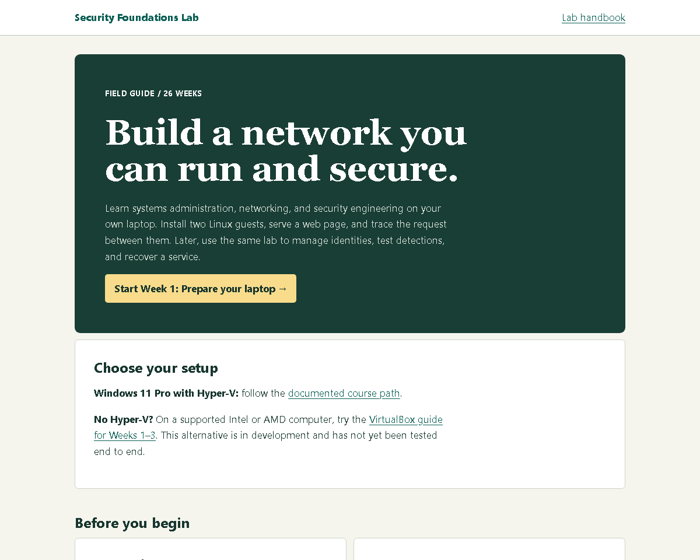

# Security Foundations Lab

**Systems administration, networking, and security engineering in one hands-on lab.**

This free, downloadable course is for people starting in IT operations, network support, or cybersecurity. Start with two virtual machines and a question: when one machine requests a web page from the other, what has to work? Configure the service, trace the packets, and use the logs to explain the result.

## Start here

1. **[Download the course ZIP](https://github.com/axumdev/security-foundations-lab/releases/latest/download/security-foundations-offline.zip)**. Alternatively, select the [course ZIP in this repository](security-foundations-offline.zip) and choose **Download raw file**.
2. Right-click the downloaded ZIP and select **Extract All**. Open **index.html** inside the extracted folder.
3. Use **Choose your setup** on the home page. Hyper-V is the documented course path. The VirtualBox walkthrough covers Weeks 1–3 and is awaiting an end-to-end pilot. If you already downloaded the entire repository, open **course/index.html** instead.

**Learning solo?** Use the handbook’s self-review checklist. Week 23 includes a personal Azure subscription path and a no-cloud alternative.

**Teaching a class?** Open **Mentor guide** from the course home page for review questions, evidence checks, and guidance on when students are ready to advance.

No web server, account, or subscription is needed to read the course. The lessons and synthetic investigation case work offline. OS installers, package updates, and the later cloud exercises require internet access. Cloud resources are separate and may incur charges; use an authorized sandbox.

## What you'll build

| Skill | What you’ll do | How you’ll know it worked |
|---|---|---|
| Systems administration | Install Linux and Windows guests, run services, and manage accounts and permissions. | Show that an authorized user can read a file and an unauthorized user cannot. |
| Networking | Address a private subnet, configure DNS, and capture HTTP traffic. | Trace a request between two guests and demonstrate that the lab has no route to the internet. |
| Security engineering | Collect endpoint and network events, write a detection rule, and test it. | Produce an alert from a known event and check a case that should not trigger it. |
| Operations and recovery | Diagnose an outage, restore a backup, and document the repair. | Repeat the client’s original request or compare the restored file’s hash with the original. |

The 26-week core starts with Windows 11 Pro, Hyper-V, Ubuntu, and a private network. It continues through Windows identity, TLS, Wazuh, endpoint logs, Suricata, incident response, recovery, and an Azure lab. Six optional modules compare Elastic, Splunk, and Security Onion using synthetic evidence. Work only with your own course VMs and authorized cloud resources.

Plan for six hours per week for the core. The extensions add about 36 hours. The guide targets a 16 GB laptop with staged VM usage; check available disk space and virtualization support in Week 1 before downloading installers. You can take one week at a time without committing to a cohort.

## Pilot status and updates

This pilot includes the whole curriculum. The first Ubuntu guest was installed, rebooted, and verified over SSH in a pilot on a larger Windows host. The entire sequence has not been tested end to end on a 16 GB laptop. Treat the weekly evidence checks as the test of your own setup.

Keep your notes and lab evidence outside the extracted course folder. When a new edition is available, download and extract it into a new folder; your existing VMs and notes can stay in place.

Found an unclear step? [Choose **Ask a lab question** or **Report a correction**](https://github.com/axumdev/security-foundations-lab/issues/new/choose). For sensitive findings, follow the [security policy](SECURITY.md). Redact credentials, personal details, and identifiers before posting.

## Maintaining the course

The editable Python sources are in **authoring/work/**. See **authoring/README.txt** for build instructions. After editing, run `python work/package_course.py` from **authoring/**. Replace the root **security-foundations-offline.zip** with the generated **outputs/security-foundations-offline.zip**, and extract that ZIP into a fresh **course/** folder for the release. Check links and the affected lab steps, then add an entry to **CHANGELOG.md**.

## Teaching, adapting, and sharing

You may copy, translate, and adapt the original lessons, mentor guide, and practice materials, including for paid classes, under [CC BY 4.0](https://creativecommons.org/licenses/by/4.0/). Credit the source, retain the license notice, and describe any changes. The authoring software and third-party materials are outside this grant. See [LICENSE.txt](LICENSE.txt).

**Credit to copy:** [Security Foundations Lab](https://github.com/axumdev/security-foundations-lab) by axumdev, licensed under [CC BY 4.0](https://creativecommons.org/licenses/by/4.0/). If adapted, add a line such as “Adapted for our class: translated Week 1 and changed the network exercise.”
